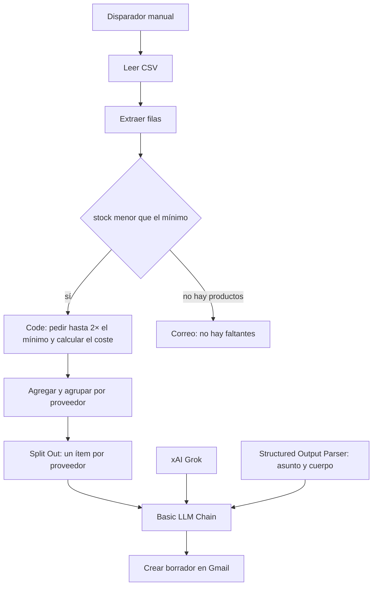

# Resumen diario de stock con n8n

Flujo de n8n que revisa el inventario de una tienda, calcula qué productos hay que reponer (hasta el doble del stock mínimo) y deja un borrador de correo por proveedor, listo para revisarlo antes de enviarlo. Si no falta nada, avisa por correo.

Los datos de ejemplo son sintéticos.

## El problema

En muchas tiendas pequeñas, la reposición se decide revisando el inventario a mano: mirar qué falta, calcular cuánto pedir y escribir un correo a cada proveedor. Es una tarea que se repite y en la que es fácil que se escape un producto o un pedido. Este flujo lo prepara solo y deja los correos en Gmail como borradores, para que una persona los revise y los envíe.

## Qué hace (versión actual)

1. **Lee el inventario** desde un CSV con el stock actual, el stock mínimo, el proveedor y el precio de coste de cada producto.
2. **Filtra** los productos cuyo stock está por debajo del mínimo.
3. **Calcula** cuántas unidades pedir de cada uno (hasta el doble del mínimo) y el coste de ese pedido, en un nodo Code en JavaScript.
4. **Agrupa** los pedidos por proveedor y los separa con Split Out, un ítem por proveedor.
5. **Redacta un correo por proveedor** con xAI Grok (Basic LLM Chain + Structured Output Parser): el modelo devuelve un `asunto` y un `cuerpo` por separado.
6. **Guarda cada correo como borrador en Gmail**, para revisarlo antes de enviarlo.
7. Si no hay productos por debajo del mínimo, **envía un aviso** de que no hay pedidos.

Además incluye un **flujo de errores** aparte: si algo falla, llega un correo con el nombre del flujo, el último nodo que se ejecutó, el mensaje de error y el enlace a la ejecución.



El parser de salida estructurada obliga al modelo a responder con este esquema:

```json
{
  "asunto": "Pedido de reposición",
  "cuerpo": "Estimados señores..."
}
```

Así el asunto y el cuerpo llegan por separado al nodo de Gmail, en lugar de un bloque de texto libre.

## Versión anterior

En `workflows/resumen-diario-stock.json` sigue el flujo anterior: un solo correo con el resumen de pedidos agrupado por proveedor, sin IA y sin borradores. El CSV, el Docker y el flujo de errores son los mismos.

## Tecnologías

- **n8n** (Community Edition) sobre **Docker**.
- Nodos: lectura de fichero, extracción de CSV, Filter, If, Code (JavaScript), Aggregate, Edit Fields, Split Out y Gmail (borrador o envío).
- **xAI Grok**, **Basic LLM Chain** y **Structured Output Parser** para redactar cada correo.
- **Error Trigger** en un flujo aparte para avisar de fallos.

## Estructura

```
.
├── workflows
│   ├── agente-stock.json            # flujo actual: borradores por proveedor con IA
│   ├── resumen-diario-stock.json    # versión anterior: un solo correo-resumen
│   └── error-workflow.json          # aviso por correo cuando algo falla
├── datos
│   └── productos_inventados.csv     # inventario de ejemplo (datos ficticios)
└── docker-compose.yml               # n8n local con la carpeta datos montada
```

## Cómo ponerlo en marcha

Necesitas Docker Desktop instalado.

1. Levanta n8n desde esta carpeta:

   ```powershell
   docker compose up -d
   ```

   Abre http://localhost:5678 y crea tu usuario. La carpeta `datos` queda montada en `/home/node/datos`, que es donde el flujo busca el CSV.

2. Importa los flujos desde **Workflows → Import from File**:
   - `workflows/agente-stock.json` (flujo principal)
   - `workflows/error-workflow.json` (aviso de errores)

3. Crea en n8n estas credenciales y asígnalas a los nodos correspondientes. En los JSON aparecen como `REEMPLAZAR`:
   - **Gmail (OAuth2)**, en el nodo de borradores y en el aviso de que no hay faltantes (y en el flujo de errores).
   - **xAI API**, en el nodo xAI Grok Chat Model.

4. Cambia el destinatario `tu-email@example.com` en los nodos de Gmail por tu dirección. En el flujo de errores el placeholder es `tu-correo@ejemplo.com`.

5. En los ajustes del flujo principal, elige **Error Workflow** como flujo de errores.

6. Ejecuta el flujo con **Execute workflow**. Revisa los borradores en Gmail antes de enviarlos. Para que se ejecute solo cada día, cambia el disparador manual por un **Schedule Trigger** a la hora que te venga bien (la zona horaria ya está en Europe/Madrid).

Para adaptarlo a una tienda real basta con sustituir el CSV por el inventario exportado del sistema que se use, con las mismas columnas: `id, nombre, categoria, stock, stock_minimo, proveedor, precio_coste`.

## Nota

Los productos, proveedores y cifras del CSV son inventados. Los JSON no llevan credenciales ni direcciones de correo reales.
